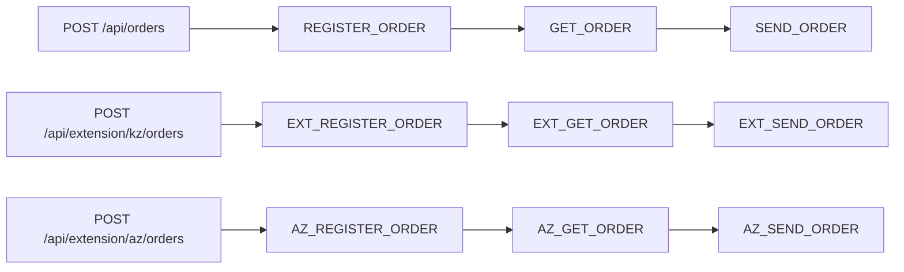

# Асинхронные цепочки заказов и Maven-расширения KZ/AZ

Демонстрационный проект на Java 21, Spring Boot 3.5.16 и db-scheduler 16.12.0.
Очередь, блокировки задач, пул исполнителей, heartbeat, восстановление и backoff
предоставляет db-scheduler со Spring Boot Starter. Собственных executor, очередей,
планировщиков и фоновых relay-процессов нет.

## Репозитории и получение исходников

Библиотеки вынесены в самостоятельные публичные репозитории:

- [orders-extension-kz](https://github.com/AbOvoUsqueAdMala/orders-extension-kz)
- [orders-extension-az](https://github.com/AbOvoUsqueAdMala/orders-extension-az)

Демо фиксирует их версии исходников через Git submodules. Клонируйте вместе с ними:

```shell
git clone --recurse-submodules https://github.com/AbOvoUsqueAdMala/demo-lib-tasks.git
cd demo-lib-tasks
```

Для уже существующего checkout:

```shell
git submodule update --init --recursive
```

Если эти каталоги раньше содержали обычные файлы, сохраните или закоммитьте свои
локальные изменения перед обновлением структуры репозитория.

Отдельный Git-репозиторий и Maven-модуль — разные понятия: в демо обе библиотеки
остаются модулями общего Maven reactor, хотя исходники и история принадлежат
разным репозиториям. Поэтому прежние команды сборки и подсветка в IDEA сохраняются.
В другом проекте достаточно Maven-зависимостей; включать submodules не обязательно.

## Запуск

Нужны JDK 21, Maven 3.6.3+ и работающий Docker с Linux-контейнерами.
Команды выполняются из корня проекта.

```shell
docker compose up -d --wait
mvn clean verify
java -jar demo-app/target/demo-app-1.0.0-SNAPSHOT.jar
```

PostgreSQL доступен на `localhost:5432`, WireMock — на `localhost:8081`,
приложение — на `localhost:8080`. База, пользователь и пароль для локального демо:
`demo`. Compose сохраняет PostgreSQL в именованном томе. WireMock использует
маппинги из каталога `wiremock/mappings`.

## Выбор библиотек

Профили независимы; включайте нужные при сборке из корня проекта:

| Состав приложения | Команда |
|---|---|
| Без библиотек | `mvn clean verify` |
| Только KZ | `mvn -Pextension-kz clean verify` |
| Только AZ | `mvn -Pextension-az clean verify` |
| KZ и AZ вместе | `mvn "-Pextension-kz,extension-az" clean verify` |

Для быстрой сборки без тестов замените `verify` на `package -DskipTests`, например:

```shell
mvn "-Pextension-kz,extension-az" clean package -DskipTests
```

После любого варианта сборки запускайте полученный JAR одной командой:

```shell
java -jar demo-app/target/demo-app-1.0.0-SNAPSHOT.jar
```

Выбор фиксируется при сборке: Maven-профили добавляют зависимости в `demo-app`.
Spring-профили при запуске не могут подключить отсутствующую в JAR библиотеку.
Все три модуля собираются в reactor и видны IDE всегда; в итоговый JAR приложения
попадают только выбранные расширения. Основная цепочка доступна во всех вариантах.

Остановить инфраструктуру с сохранением данных: `docker compose down`.
Testcontainers использует отдельную временную базу и не затрагивает базу Compose.

## Пересборка после изменений в библиотеках

Все команды ниже выполняются из корня проекта, где находится общий `pom.xml`.
Перед пересборкой остановите запущенное приложение, затем выберите нужный состав
библиотек — он не зависит от того, в какой из них вы изменили код.

Самый простой вариант — собрать весь проект. Например, после изменений в KZ
или AZ для приложения с обеими библиотеками:

```shell
mvn "-Pextension-kz,extension-az" clean verify
```

Maven заново соберёт все три модуля и включит актуальные JAR выбранных библиотек
в приложение. `clean` удаляет предыдущие результаты сборки, а `verify` выполняет
сборку и проверки, включая интеграционные тесты. При сборке всего проекта `-am`
не требуется; отдельно устанавливать библиотеки в локальный репозиторий `.m2`
тоже не нужно — Maven использует артефакты из текущей сборки.

Если нужно выбрать только приложение и необходимые ему модули, используйте
`-pl demo-app -am`:

- `-pl demo-app` (`--projects`) выбирает модуль приложения для сборки.
- `-am` (`--also-make`, **also make**) добавляет к сборке модули этого же проекта,
  от которых зависит выбранное приложение, включая их зависимости в reactor.
- Профили определяют зависимости: `-am` сам не включает KZ или AZ.

| Требуемый состав приложения | Пересборка приложения и его зависимостей |
|---|---|
| Без библиотек | `mvn -pl demo-app -am clean verify` |
| Только KZ | `mvn -pl demo-app -am -Pextension-kz clean verify` |
| Только AZ | `mvn -pl demo-app -am -Pextension-az clean verify` |
| KZ и AZ вместе | `mvn -pl demo-app -am "-Pextension-kz,extension-az" clean verify` |

Например, если изменён KZ, а приложение должно по-прежнему содержать обе библиотеки,
используйте последнюю команду таблицы. Maven пересоберёт обе зависимости и приложение.
Для быстрой сборки без тестов:

```shell
mvn -pl demo-app -am "-Pextension-kz,extension-az" clean package -DskipTests
```

При использовании `-pl demo-app` без `-am` библиотечные модули не собираются.
Maven разрешает их зависимости через локальный и настроенные удалённые репозитории.
Если там находится прежний JAR KZ или AZ, в приложение попадёт его код, а изменения
исходников библиотеки в рабочем каталоге не будут учтены. Если подходящего артефакта
нет, сборка завершится ошибкой разрешения зависимости.

Версии библиотек автоматически не увеличиваются: каждая задаёт
`1.0.0-SNAPSHOT` в собственном `pom.xml` с родителем Spring Boot.
В демо версии зависимостей задаются отдельно свойствами
`orders-extension-kz.version` и `orders-extension-az.version`.
Изменение исходников и пересборка обновляют содержимое JAR с той же версией.
При выпуске новой версии библиотеки обновите и соответствующее свойство демо.

Если библиотека находится в отдельном checkout вне текущего reactor, сначала
выполните в её каталоге `mvn clean install`, затем пересоберите приложение.
Один `-am` не собирает исходники из произвольных внешних Git-репозиториев.

После успешной сборки заново запустите приложение:

```shell
java -jar demo-app/target/demo-app-1.0.0-SNAPSHOT.jar
```

Уже работающий процесс автоматически не переключается на пересобранные библиотеки.

## REST API

Основная цепочка:

```http
POST /api/orders
Content-Type: application/json

{"description":"Демонстрационный заказ"}
```

Ответ: `202 Accepted`, заголовок `Location: /api/orders/{id}` и JSON заказа.
Поле `description` обязательно, от 1 до 200 символов, не может состоять из пробелов.
Начальный статус — `NEW`.

Пример для PowerShell:

```powershell
$order = Invoke-RestMethod http://localhost:8080/api/orders -Method Post -ContentType application/json -Body '{"description":"Demo order"}'
Invoke-RestMethod "http://localhost:8080/api/orders/$($order.id)"
```

Методы расширений регистрируются только при подключении соответствующей библиотеки:

| Метод | Путь | Назначение |
|---|---|---|
| POST | /api/orders | Запуск основной цепочки |
| GET | /api/orders/{id} | Состояние и история основного заказа |
| POST | /api/extension/kz/orders | Запуск цепочки KZ |
| GET | /api/extension/kz/orders/{id} | Состояние и история заказа KZ |
| POST | /api/extension/az/orders | Запуск цепочки AZ |
| GET | /api/extension/az/orders/{id} | Состояние и история заказа AZ |
| GET | /actuator/health | Проверка состояния приложения |

История содержит имя шага, `SUCCESS` или `FAILURE`, результат, краткую ошибку и время.
Результат регистрации — внешний идентификатор, получения — JSON заказа,
отправки — подтверждение `Delivered`. Неизвестный UUID возвращает `404`,
невалидный запрос — `400`; используется Spring ProblemDetail.
Заказы трёх систем имеют отдельные хранилища и GET-методы. Например, при
сборке только с AZ запрос к `/api/extension/kz/orders` возвращает `404`.
Для совместимости прежний путь `/api/extension/orders` остаётся алиасом KZ;
ответ `Location` использует канонический путь `/api/extension/kz/orders/{id}`.

Примеры запуска обеих цепочек расширений в PowerShell:

```powershell
$kzOrder = Invoke-RestMethod http://localhost:8080/api/extension/kz/orders -Method Post -ContentType application/json -Body '{"description":"KZ order"}'
$azOrder = Invoke-RestMethod http://localhost:8080/api/extension/az/orders -Method Post -ContentType application/json -Body '{"description":"AZ order"}'
Invoke-RestMethod "http://localhost:8080/api/extension/kz/orders/$($kzOrder.id)"
Invoke-RestMethod "http://localhost:8080/api/extension/az/orders/$($azOrder.id)"
```

## Структура

```text
demo-app/
  src/main/java/com/example/demo/
    controller/
    model/dto/
    model/entity/
    repository/
    service/
    tasks/
    config/
  src/main/resources/db/migration/app/
  src/test/java/com/example/demo/OrderChainsIT.java
orders-extension-kz/
  src/main/java/com/example/extension/kz/
    controller/
    model/dto/
    model/entity/
    repository/
    service/
    tasks/
    config/
  src/main/resources/
    orders-extension-kz/db/migration/
    META-INF/spring/org.springframework.boot.autoconfigure.AutoConfiguration.imports
orders-extension-az/
  src/main/java/com/example/extension/az/
    controller/
    model/dto/
    model/entity/
    repository/
    service/
    tasks/
    config/
  src/main/resources/
    orders-extension-az/db/migration/
    META-INF/spring/org.springframework.boot.autoconfigure.AutoConfiguration.imports
wiremock/mappings/
compose.yml
```

## Выполнение и транзакции



KZ сохраняет прежние имена задач `EXT_*`, чтобы очередь существующей библиотеки
продолжила обрабатываться после переименования. AZ использует отдельные имена
`AZ_*`. При подключении обеих библиотек один Scheduler регистрирует девять
обработчиков; без библиотек — три, с одной — шесть.

Статусы: `NEW → REGISTERED → FETCHED → SENT`; при окончательной ошибке — `FAILED`.
Каждый шаг — отдельная одноразовая задача db-scheduler. В payload задачи хранится
только UUID через instance ID; бизнес-данные читаются из JPA.

1. Создание заказа и постановка `REGISTER_ORDER` выполняются в одной JPA-транзакции.
2. Обработчик читает заказ, затем вызывает HTTP вне транзакции и блокировки строки.
3. Короткая транзакция `complete` блокирует строку заказа, проверяет ожидаемый статус,
   сохраняет результат и ставит следующий шаг через `scheduleIfNotExists`.
4. После commit обработчик возвращает управление db-scheduler. Удаление завершённой
   задачи выполняет сама библиотека. Ожидания дочернего шага нет; он может стартовать
   на другом потоке сразу после commit.

Стартер db-scheduler 16.12.0 оборачивает DataSource в
`TransactionAwareDataSourceProxy`. Его `SchedulerClient` участвует в той же
транзакции `JpaTransactionManager`, что и Hibernate: запись заказа, история
и INSERT следующей задачи откатываются вместе. Отдельной after-commit постановки нет.
Immediate execution отключён; задачи подбираются polling после видимости commit.

Ключ очереди — пара `(task_name, task_instance)`, instance ID равен UUID заказа.
Дополнительно переход состояния защищён блокировкой и проверкой статуса: если процесс
упал после commit, но до удаления родительской задачи, её повторный запуск пропустит
уже выполненный шаг. Даже если дочерняя задача уже удалена после выполнения,
сохранённый статус не позволит повторно создать её.

Заказы независимы; блокировка берётся только на конкретный заказ и только на время
сохранения. Общий пул db-scheduler по умолчанию содержит четыре потока.

## Повторы и восстановление

- HTTP `408`, `429`, `5xx`, ошибки соединения и timeout передаются db-scheduler
  для повторного запуска. RestClient сам повторов не добавляет.
- Остальные HTTP `4xx`, ошибки декодирования ответа регистрации и некорректный
  ответ регистрации/пустой ответ получения
  переводят заказ в `FAILED` без создания следующей задачи.
- Встроенный `FailureHandler.maxRetries` выполняет по умолчанию пять повторов
  после первой попытки с backoff: 2, 4, 8, 16, 32 секунды. После исчерпания
  повторов заказ становится `FAILED`, задача удаляется, история сохраняется.
  Неожиданные ошибки обработчика, включая ошибки БД, также обрабатывает этот handler.
- Connect timeout — 2 секунды, read timeout — 5 секунд. Для WireMock выбран HTTP/1.1.
- После штатного рестарта сохранённые ожидающие задачи подбираются автоматически.
  После аварийного завершения picked-задачи возвращает в обработку стандартный
  dead-execution handler по истечении heartbeat-порога и очередной проверки.
  При настройках демо порог — 30 секунд; это не обещание точного времени восстановления.

HTTP-вызов и commit PostgreSQL не являются распределённой транзакцией. При падении
после внешнего эффекта, но до commit HTTP может повториться. Для POST передаётся
стабильный `Idempotency-Key: <имя задачи>:<UUID>`; реальный получатель должен
обеспечивать долговременную дедупликацию по этому ключу. WireMock проверяет наличие
ключа, возвращает детерминированный внешний ID и не моделирует реальное хранилище
внешних побочных эффектов. Гарантия exactly-once HTTP здесь не заявляется.

## Независимые миграции

| Владелец | Схема PostgreSQL | Путь миграций | Таблица истории |
|---|---|---|---|
| Приложение | app | classpath:db/migration/app | app.app_schema_history |
| KZ | orders_extension | classpath:orders-extension-kz/db/migration | orders_extension.extension_schema_history |
| AZ | orders_extension_az | classpath:orders-extension-az/db/migration | orders_extension_az.az_schema_history |

В каждой схеме свои `V1` без конфликта версий. Общая очередь
`app.scheduled_tasks` создаётся миграцией приложения `V2`.
Flyway приложения и выбранных расширений запускаются через
`FlywayMigrationInitializer`; Hibernate и db-scheduler
зависят от завершения инициализации базы. Hibernate только проверяет схему:
`ddl-auto=validate`.

На новой базе создаются только схемы выбранных расширений. Без обоих профилей
в приложении нет их классов, миграций, Entity, Repository, обработчиков и REST API.

Ресурсы библиотек размещены вне стандартного `classpath:db/migration`,
поэтому Flyway другого приложения не подбирает их как собственные миграции.
Автоконфигурация расширений сохраняет стандартный Flyway приложения и добавляет
свои инициализаторы после его автоконфигурации.

У KZ сохранены схема `orders_extension`, таблицы, история Flyway и миграция V1
прежнего модуля `orders-extension`. Переименование Maven-артефакта и Java-пакета
не требует переноса существующих заказов. Прежний профиль `extension` заменён
на `extension-kz`.

При отключении ранее использованной библиотеки её таблицы остаются в БД.
Перед отключением расширения дождитесь завершения его задач: без соответствующих
обработчиков они не исполняются. Для длительного отключения учитывайте стандартную
настройку db-scheduler `delete-unresolved-after`, которая определяет срок хранения
задач с неизвестными обработчиками.

## Подключение Maven-библиотек

Профиль `extension-kz` добавляет зависимость `orders-extension-kz` в `demo-app`,
а `extension-az` — `orders-extension-az`. Библиотеки независимы друг от друга
и не зависят от приложения или его родительского POM. Каждая собирается отдельно:

```shell
mvn -f orders-extension-kz/pom.xml clean install
mvn -f orders-extension-az/pom.xml clean install
```

Эти команды работают и в независимо клонированных репозиториях. Для установки
артефактов из общего reactor демо:

```shell
mvn "-Pextension-kz,extension-az" clean install -DskipTests
```

В другом совместимом Spring Boot-приложении добавьте нужную зависимость или обе
после установки библиотек в локальный Maven:

```xml
<dependency>
    <groupId>com.example</groupId>
    <artifactId>orders-extension-kz</artifactId>
    <version>1.0.0-SNAPSHOT</version>
</dependency>
<dependency>
    <groupId>com.example</groupId>
    <artifactId>orders-extension-az</artifactId>
    <version>1.0.0-SNAPSHOT</version>
</dependency>
```

Автоконфигурация импортирует сервисы, контроллер, task beans, JPA Entity и Repository
библиотеки без `@ComponentScan` в её пакеты и без ручного изменения приложения.
Нужны PostgreSQL DataSource, JDBC-драйвер PostgreSQL и таблица общего db-scheduler.
В демо их предоставляет `demo-app`. В другом приложении создайте таблицу своей
Flyway-миграцией; SQL есть в `docs/scheduled_tasks.sql` каждого репозитория.
Имя таблицы задаётся общим `db-scheduler.table-name`; отдельный Scheduler
библиотека не создаёт. JPA, MVC, Flyway и db-scheduler starter приходят транзитивно.
Минимальные свойства и HTTP-контракты описаны в README каждой библиотеки.

GitHub хранит исходники, а Maven получает зависимости из Maven-репозитория.
Для сборки на другой машине также выполните `mvn install` библиотек либо
опубликуйте их JAR и POM через `mvn deploy` в Nexus/Artifactory вашей организации.
Само создание GitHub-репозитория не публикует артефакт в Maven Central.

Изменения библиотек коммитятся и отправляются в их собственные репозитории.
После этого в демо зафиксируйте новые указатели submodules:

```shell
git -C orders-extension-kz add .
git -C orders-extension-kz commit -m "Update KZ extension"
git -C orders-extension-kz push origin HEAD:main
git add orders-extension-kz
git commit -m "Update KZ submodule"
```

Для AZ используйте соответствующий каталог. При получении изменений демо выполните
`git submodule update --init --recursive`, чтобы взять именно зафиксированные
коммиты библиотек.

## IntelliJ IDEA

Открывайте корневой `pom.xml` как Maven-проект. Все три модуля объявлены в общем
списке `<modules>`, поэтому IDEA импортирует `orders-extension-kz` и
`orders-extension-az` с зависимостями, подсветкой, автодополнением и навигацией
независимо от выбранных профилей.
После изменения POM выполните **View → Tool Windows → Maven → Reload All Maven Projects**
(в некоторых версиях действие называется **Sync All Maven Projects**).

В **Maven → Profiles** выберите `extension-kz`, `extension-az`, оба флажка
или снимите оба. Затем обновите Maven-проект. Для редактирования исходников
расширений включать профили не требуется. При запуске приложения из IDE выбранные
библиотеки входят в classpath. В отдельном терминале выбор задавайте явно через
`-Pextension-kz`, `-Pextension-az` или `"-Pextension-kz,extension-az"`.

## Настройки

| Переменная окружения | Значение по умолчанию |
|---|---|
| DATABASE_URL | jdbc:postgresql://localhost:5432/demo |
| DATABASE_USER | demo |
| DATABASE_PASSWORD | demo |
| DATABASE_POOL_SIZE | 16 |
| SCHEDULER_THREADS | 4 |
| ORDERS_BASE_URL | http://localhost:8081 |
| KZ_ORDERS_BASE_URL | http://localhost:8081 |
| AZ_ORDERS_BASE_URL | http://localhost:8081 |
| ORDER_RETRY_DELAY | 2s |
| ORDER_MAX_RETRIES | 5 |

KZ и AZ используют свойства `orders.extension.kz.base-url` и
`orders.extension.az.base-url` и разные пути WireMock: `/kz/...` и `/az/...`.
Для KZ старая переменная `EXTENSION_ORDERS_BASE_URL` остаётся резервным значением,
если `KZ_ORDERS_BASE_URL` не задана.

Остальные настройки db-scheduler доступны через обычные Spring properties.
При увеличении числа потоков согласуйте пул БД и возможности внешних систем.

## Проверки

Независимые проверки библиотек (каждая с собственным тестовым приложением):

```shell
mvn -f orders-extension-kz/pom.xml clean verify
mvn -f orders-extension-az/pom.xml clean verify
```

Проверки приложения во всех сочетаниях зависимостей:

```shell
mvn clean verify
mvn -Pextension-kz clean verify
mvn -Pextension-az clean verify
mvn "-Pextension-kz,extension-az" clean verify
```

Та же матрица из четырёх сборок настроена в GitHub Actions.
Failsafe запускает `OrderChainsIT` после упаковки JAR. Testcontainers поднимает
PostgreSQL 17.6; WireMock стартует на случайном порту с теми же маппингами, что Compose.
Отсутствие Docker является ошибкой проверки: тесты не пропускаются автоматически.
Проверяются:

- состав итогового JAR, наличие только выбранных расширений, одного Scheduler и 3/6/9 обработчиков;
- независимые миграции и отсутствие схем/API отключённых расширений;
- выполнение нескольких цепочек и перекрытие HTTP-запросов во времени;
- временные и постоянные HTTP-ошибки, повреждённый ответ регистрации,
  backoff и исчерпание повторов;
- атомарный rollback заказа/первой задачи и состояния/дочерней задачи;
- повтор родителя до и после завершения цепочки без дублирования результата;
- рестарт контекста с сохранёнными задачами и восстановление устаревших picked-записей;
- валидация REST и `404` для неизвестных заказов.

Если Windows-среда запуска использует длинный/перенаправленный TEMP и JVM выдаёт
`Unable to establish loopback connection` при старте WireMock, задайте короткий
временный путь только для текущего PowerShell-процесса:

```powershell
New-Item -ItemType Directory -Force .build/tmp | Out-Null
$env:TEMP = (Resolve-Path .build/tmp).Path
$env:TMP = $env:TEMP
mvn clean verify
mvn -Pextension-kz clean verify
mvn -Pextension-az clean verify
mvn "-Pextension-kz,extension-az" clean verify
```

Документация: [db-scheduler](https://github.com/kagkarlsson/db-scheduler/tree/v16.12.0),
[транзакционная постановка](https://github.com/kagkarlsson/db-scheduler/blob/v16.12.0/examples/spring-boot-example/src/main/java/com/github/kagkarlsson/examples/boot/config/TransactionallyStagedJobConfiguration.java),
[Spring Boot 3.5](https://docs.spring.io/spring-boot/3.5/reference/).
