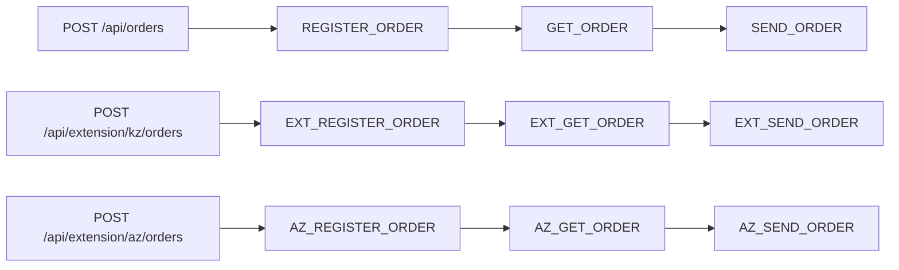

# Асинхронные цепочки заказов и отдельные библиотеки KZ/AZ

Демо на Java 21, Spring Boot 3.5.16 и db-scheduler 16.12.0.
Очередь, многопоточность, heartbeat, повторы и восстановление предоставляет
db-scheduler со Spring Boot Starter. Собственной инфраструктуры очередей нет.

## Три независимых проекта

Исходники находятся в отдельных Git-репозиториях:

- [Демо-приложение](https://github.com/AbOvoUsqueAdMala/demo-lib-tasks)
- [orders-extension-kz](https://github.com/AbOvoUsqueAdMala/orders-extension-kz)
- [orders-extension-az](https://github.com/AbOvoUsqueAdMala/orders-extension-az)

Разместите checkout рядом в общей рабочей папке. Она сама не является Git-репозиторием:

```shell
git clone https://github.com/AbOvoUsqueAdMala/demo-lib-tasks.git demo-project
git clone https://github.com/AbOvoUsqueAdMala/orders-extension-kz.git
git clone https://github.com/AbOvoUsqueAdMala/orders-extension-az.git
```

У каждого проекта своя `.git`, история, POM и сборка. В демо нет submodules
и исходников библиотек. Его Maven reactor содержит родительский POM и модуль
`demo-app`; KZ и AZ подключаются обычными внешними зависимостями.

## Ветки и состав приложения

| Ветка | Подключение библиотек | Команда сборки |
|---|---|---|
| `master` | KZ и AZ, обычные Maven-зависимости | `mvn clean verify` |
| `client-KZ` | Только KZ, обычная Maven-зависимость | `mvn clean verify` |
| `client-AZ` | Только AZ, обычная Maven-зависимость | `mvn clean verify` |
| `build-with-maven-profiles` | Выбор через Maven-профили | См. README этой ветки |

Текущая ветка: **`client-KZ`**, состав: **только KZ**.
В `pom.xml` и `demo-app/pom.xml` этой ветки нет Maven-профилей расширений.
Библиотеки подключены в обычной секции `<dependencies>` модуля `demo-app`,
версии управляются родительским POM. Флаг `-P` не требуется.

Ветка `build-with-maven-profiles` сохраняет прежний вариант приложения:

```shell
git switch build-with-maven-profiles
mvn clean verify
mvn -Pextension-kz clean verify
mvn -Pextension-az clean verify
mvn "-Pextension-kz,extension-az" clean verify
```

Соответственно собираются приложение без расширений, только с KZ, только с AZ
или с обеими библиотеками. Перед сборкой установите выбранные библиотеки.
Для возврата к текущему варианту: `git switch client-KZ`.

Клиентские ветки созданы от `master`, но намеренно имеют другой состав POM.
При последующих слияниях проверяйте зависимости, тестовые свойства
`extension.kz.expected` / `extension.az.expected` и CI: Git не закрепляет
клиентский состав автоматически и может перенести изменения из другой ветки.
Свойства `extension.*.expected` задают ожидания интеграционных тестов,
а не включают библиотеки в работающем приложении.

## Подготовка и запуск

Нужны JDK 21, Maven 3.6.3+ и Docker для интеграционных тестов.
Из каталога `demo-project` установите библиотеки текущей ветки:

```shell
mvn -f ../orders-extension-kz/pom.xml clean install
mvn clean verify
docker compose up -d --wait
java -jar demo-app/target/demo-app-1.0.0-SNAPSHOT.jar
```

Установка помещает JAR и POM в `.m2` текущего пользователя. Вместо локальной
установки можно использовать Maven-репозиторий вашей организации с опубликованными
артефактами. Для быстрой сборки без тестов: `mvn clean package -DskipTests`.

PostgreSQL доступен на `localhost:5432`, WireMock — на `localhost:8081`,
приложение — на `localhost:8080`. Локальная БД, пользователь и пароль — `demo`.
Compose сохраняет PostgreSQL в именованном томе; остановка с сохранением данных:
`docker compose down`. Testcontainers использует отдельную временную базу.
WireMock читает маппинги из `wiremock/mappings`.

## Пересборка после изменений в библиотеках

Из каталога `demo-project` заново установите изменённую библиотеку,
которая подключена в текущей ветке, затем пересоберите приложение.
Например, полная пересборка состава этой ветки:

```shell
mvn -f ../orders-extension-kz/pom.xml clean install
mvn clean verify
```

Если изменена только одна из двух библиотек, повторный `install` другой не нужен.
Без повторного `install` демо может получить прежний JAR из `.m2`.
Остановите приложение перед пересборкой и запустите его заново после неё:
работающий процесс автоматически не переключается на новый код.

### Что делают Maven-флаги

- `-P` (`--activate-profiles`) включает Maven-профили. Профили `extension-kz`
  и `extension-az` определены только в ветке `build-with-maven-profiles`.
- `-pl demo-app` (`--projects`) выбирает модуль приложения.
- `-am` (`--also-make`, **also make**) добавляет зависимости выбранного модуля,
  только если они входят в текущий Maven reactor.

Например, `mvn -pl demo-app -am clean verify` соберёт приложение
и его родительский проект, но не соседние репозитории библиотек. Их нужно
предварительно собрать командами `mvn -f ../orders-extension-*/pom.xml clean install`,
подставив конкретное имя каталога вместо `*`.
Для обычной сборки демо из его корня `-pl` и `-am` не требуются.

Версии библиотек задаются независимо в их POM и сейчас равны `1.0.0-SNAPSHOT`.
Они не увеличиваются автоматически. В демо версии подключённых зависимостей
задают свойства `orders-extension-kz.version` / `orders-extension-az.version`.
При выпуске новой версии библиотеки обновите соответствующее свойство демо.

## REST API

Основная цепочка:

```http
POST /api/orders
Content-Type: application/json

{"description":"Демонстрационный заказ"}
```

Ответ: `202 Accepted`, заголовок `Location: /api/orders/{id}` и JSON заказа.
Поле `description` обязательно, от 1 до 200 символов, не может состоять из пробелов.
Начальный статус — `NEW`.

Пример для PowerShell:

```powershell
$order = Invoke-RestMethod http://localhost:8080/api/orders -Method Post -ContentType application/json -Body '{"description":"Demo order"}'
Invoke-RestMethod "http://localhost:8080/api/orders/$($order.id)"
```

Методы расширений регистрируются только при подключении соответствующей библиотеки:

| Метод | Путь | Назначение |
|---|---|---|
| POST | /api/orders | Запуск основной цепочки |
| GET | /api/orders/{id} | Состояние и история основного заказа |
| POST | /api/extension/kz/orders | Запуск цепочки KZ |
| GET | /api/extension/kz/orders/{id} | Состояние и история заказа KZ |
| POST | /api/extension/az/orders | Запуск цепочки AZ |
| GET | /api/extension/az/orders/{id} | Состояние и история заказа AZ |
| GET | /actuator/health | Проверка состояния приложения |

История содержит имя шага, `SUCCESS` или `FAILURE`, результат, краткую ошибку и время.
Результат регистрации — внешний идентификатор, получения — JSON заказа,
отправки — подтверждение `Delivered`. Неизвестный UUID возвращает `404`,
невалидный запрос — `400`; используется Spring ProblemDetail.
Заказы трёх систем имеют отдельные хранилища и GET-методы. Например, при
сборке только с AZ запрос к `/api/extension/kz/orders` возвращает `404`.
Для совместимости прежний путь `/api/extension/orders` остаётся алиасом KZ;
ответ `Location` использует канонический путь `/api/extension/kz/orders/{id}`.

Примеры запуска обеих цепочек расширений в PowerShell:

```powershell
$kzOrder = Invoke-RestMethod http://localhost:8080/api/extension/kz/orders -Method Post -ContentType application/json -Body '{"description":"KZ order"}'
$azOrder = Invoke-RestMethod http://localhost:8080/api/extension/az/orders -Method Post -ContentType application/json -Body '{"description":"AZ order"}'
Invoke-RestMethod "http://localhost:8080/api/extension/kz/orders/$($kzOrder.id)"
Invoke-RestMethod "http://localhost:8080/api/extension/az/orders/$($azOrder.id)"
```

## Структура рабочей папки

```text
workspace/                         # Не Git-репозиторий
├── demo-project/                  # Репозиторий demo-lib-tasks
│   ├── .git/
│   ├── pom.xml
│   ├── demo-app/
│   │   ├── src/main/java/com/example/demo/
│   │   ├── src/main/resources/db/migration/app/
│   │   └── src/test/java/com/example/demo/OrderChainsIT.java
│   ├── wiremock/mappings/
│   └── compose.yml
├── orders-extension-kz/           # Отдельный репозиторий
│   ├── .git/
│   ├── pom.xml
│   ├── README.md
│   └── src/
└── orders-extension-az/           # Отдельный репозиторий
    ├── .git/
    ├── pom.xml
    ├── README.md
    └── src/
```

## Выполнение и транзакции



KZ сохраняет прежние имена задач `EXT_*`, чтобы очередь существующей библиотеки
продолжила обрабатываться после переименования. AZ использует отдельные имена
`AZ_*`. При подключении обеих библиотек один Scheduler регистрирует девять
обработчиков; без библиотек — три, с одной — шесть.

Статусы: `NEW → REGISTERED → FETCHED → SENT`; при окончательной ошибке — `FAILED`.
Каждый шаг — отдельная одноразовая задача db-scheduler. В payload задачи хранится
только UUID через instance ID; бизнес-данные читаются из JPA.

1. Создание заказа и постановка `REGISTER_ORDER` выполняются в одной JPA-транзакции.
2. Обработчик читает заказ, затем вызывает HTTP вне транзакции и блокировки строки.
3. Короткая транзакция `complete` блокирует строку заказа, проверяет ожидаемый статус,
   сохраняет результат и ставит следующий шаг через `scheduleIfNotExists`.
4. После commit обработчик возвращает управление db-scheduler. Удаление завершённой
   задачи выполняет сама библиотека. Ожидания дочернего шага нет; он может стартовать
   на другом потоке сразу после commit.

Стартер db-scheduler 16.12.0 оборачивает DataSource в
`TransactionAwareDataSourceProxy`. Его `SchedulerClient` участвует в той же
транзакции `JpaTransactionManager`, что и Hibernate: запись заказа, история
и INSERT следующей задачи откатываются вместе. Отдельной after-commit постановки нет.
Immediate execution отключён; задачи подбираются polling после видимости commit.

Ключ очереди — пара `(task_name, task_instance)`, instance ID равен UUID заказа.
Дополнительно переход состояния защищён блокировкой и проверкой статуса: если процесс
упал после commit, но до удаления родительской задачи, её повторный запуск пропустит
уже выполненный шаг. Даже если дочерняя задача уже удалена после выполнения,
сохранённый статус не позволит повторно создать её.

Заказы независимы; блокировка берётся только на конкретный заказ и только на время
сохранения. Общий пул db-scheduler по умолчанию содержит четыре потока.

## Повторы и восстановление

- HTTP `408`, `429`, `5xx`, ошибки соединения и timeout передаются db-scheduler
  для повторного запуска. RestClient сам повторов не добавляет.
- Остальные HTTP `4xx`, ошибки декодирования ответа регистрации и некорректный
  ответ регистрации/пустой ответ получения
  переводят заказ в `FAILED` без создания следующей задачи.
- Встроенный `FailureHandler.maxRetries` выполняет по умолчанию пять повторов
  после первой попытки с backoff: 2, 4, 8, 16, 32 секунды. После исчерпания
  повторов заказ становится `FAILED`, задача удаляется, история сохраняется.
  Неожиданные ошибки обработчика, включая ошибки БД, также обрабатывает этот handler.
- Connect timeout — 2 секунды, read timeout — 5 секунд. Для WireMock выбран HTTP/1.1.
- После штатного рестарта сохранённые ожидающие задачи подбираются автоматически.
  После аварийного завершения picked-задачи возвращает в обработку стандартный
  dead-execution handler по истечении heartbeat-порога и очередной проверки.
  При настройках демо порог — 30 секунд; это не обещание точного времени восстановления.

HTTP-вызов и commit PostgreSQL не являются распределённой транзакцией. При падении
после внешнего эффекта, но до commit HTTP может повториться. Для POST передаётся
стабильный `Idempotency-Key: <имя задачи>:<UUID>`; реальный получатель должен
обеспечивать долговременную дедупликацию по этому ключу. WireMock проверяет наличие
ключа, возвращает детерминированный внешний ID и не моделирует реальное хранилище
внешних побочных эффектов. Гарантия exactly-once HTTP здесь не заявляется.

## Независимые миграции

| Владелец | Схема PostgreSQL | Путь миграций | Таблица истории |
|---|---|---|---|
| Приложение | app | classpath:db/migration/app | app.app_schema_history |
| KZ | orders_extension | classpath:orders-extension-kz/db/migration | orders_extension.extension_schema_history |
| AZ | orders_extension_az | classpath:orders-extension-az/db/migration | orders_extension_az.az_schema_history |

В каждой схеме свои `V1` без конфликта версий. Общая очередь
`app.scheduled_tasks` создаётся миграцией приложения `V2`.
Flyway приложения и выбранных расширений запускаются через
`FlywayMigrationInitializer`; Hibernate и db-scheduler
зависят от завершения инициализации базы. Hibernate только проверяет схему:
`ddl-auto=validate`.

На новой базе создаются только схемы библиотек, подключённых в POM текущей ветки.
Если зависимости нет, в JAR отсутствуют её классы, миграции, Entity, Repository,
обработчики и REST API. Выбор через профили сохранён в build-with-maven-profiles.

Ресурсы библиотек размещены вне стандартного `classpath:db/migration`,
поэтому Flyway другого приложения не подбирает их как собственные миграции.
Автоконфигурация расширений сохраняет стандартный Flyway приложения и добавляет
свои инициализаторы после его автоконфигурации.

У KZ сохранены схема `orders_extension`, таблицы, история Flyway и миграция V1
прежнего модуля `orders-extension`. Переименование Maven-артефакта и Java-пакета
не требует переноса существующих заказов.

При отключении ранее использованной библиотеки её таблицы остаются в БД.
Перед отключением расширения дождитесь завершения его задач: без соответствующих
обработчиков они не исполняются. Для длительного отключения учитывайте стандартную
настройку db-scheduler `delete-unresolved-after`, которая определяет срок хранения
задач с неизвестными обработчиками.

## Подключение Maven-библиотек

В этой ветке демо библиотеки добавлены обычными внешними Maven-зависимостями.
Библиотеки не зависят от POM демо, не являются его модулями и могут использоваться
в другом совместимом Spring Boot-приложении. После установки или публикации
добавьте нужную зависимость либо обе:

```xml
<dependency>
    <groupId>com.example</groupId>
    <artifactId>orders-extension-kz</artifactId>
    <version>1.0.0-SNAPSHOT</version>
</dependency>
<dependency>
    <groupId>com.example</groupId>
    <artifactId>orders-extension-az</artifactId>
    <version>1.0.0-SNAPSHOT</version>
</dependency>
```

GitHub хранит исходники, а Maven получает артефакты из Maven-репозитория.
Для другой машины также выполните `mvn install` библиотек либо опубликуйте их
через `mvn deploy` в Maven-репозиторий вашей организации.
Создание GitHub-репозитория само по себе не публикует JAR в Maven Central.

Автоконфигурация регистрирует сервисы, контроллеры, Entity, Repository и task beans.
Нужны PostgreSQL DataSource, JDBC-драйвер и одна общая таблица db-scheduler.
В демо их предоставляет `demo-app`; в другом приложении создайте таблицу своей
Flyway-миграцией. SQL есть в `docs/scheduled_tasks.sql` каждого репозитория.
Имя очереди задаётся через `db-scheduler.table-name`; отдельные Scheduler
библиотеки не создают. Остальные требования описаны в README KZ и AZ.

Правки библиотек коммитятся и отправляются из соответствующего checkout.
Обновление демо не обновляет их исходники автоматически:
используйте `git pull` в нужном репозитории, затем `mvn clean install`.

## IntelliJ IDEA

Открывайте `demo-project/pom.xml`, `orders-extension-kz/pom.xml` и
`orders-extension-az/pom.xml` как три отдельных Maven-проекта, каждый в своём окне.
У них независимые настройки, зависимости, подсветка и сборка.

В этой ветке Maven-профили выбирать не нужно. После переключения Git-ветки
или установки обновлённой библиотеки обновите Maven-проект демо. IDEA получает
библиотеки как Maven-зависимости; их код редактируйте в собственных проектах.

## Настройки

| Переменная окружения | Значение по умолчанию |
|---|---|
| DATABASE_URL | jdbc:postgresql://localhost:5432/demo |
| DATABASE_USER | demo |
| DATABASE_PASSWORD | demo |
| DATABASE_POOL_SIZE | 16 |
| SCHEDULER_THREADS | 4 |
| ORDERS_BASE_URL | http://localhost:8081 |
| KZ_ORDERS_BASE_URL | http://localhost:8081 |
| AZ_ORDERS_BASE_URL | http://localhost:8081 |
| ORDER_RETRY_DELAY | 2s |
| ORDER_MAX_RETRIES | 5 |

KZ и AZ используют свойства `orders.extension.kz.base-url` и
`orders.extension.az.base-url` и разные пути WireMock: `/kz/...` и `/az/...`.
Для KZ старая переменная `EXTENSION_ORDERS_BASE_URL` остаётся резервным значением,
если `KZ_ORDERS_BASE_URL` не задана.

Остальные настройки db-scheduler доступны через обычные Spring properties.
При увеличении числа потоков согласуйте пул БД и возможности внешних систем.

## Проверки

Независимые проверки библиотек (каждая с собственным тестовым приложением):

```shell
mvn -f ../orders-extension-kz/pom.xml clean verify
mvn -f ../orders-extension-az/pom.xml clean verify
```

Проверка приложения с составом текущей ветки:

```shell
mvn clean verify
```

GitHub Actions устанавливает только подключённые в этой ветке библиотеки
и выполняет ту же команду. Матрица из четырёх сочетаний сохранена
в ветке `build-with-maven-profiles`.
Failsafe запускает `OrderChainsIT` после упаковки JAR. Testcontainers поднимает
PostgreSQL 17.6; WireMock стартует на случайном порту с теми же маппингами, что Compose.
Отсутствие Docker является ошибкой проверки: тесты не пропускаются автоматически.
Проверяются:

- состав итогового JAR, наличие только выбранных расширений, одного Scheduler и 3/6/9 обработчиков;
- независимые миграции и отсутствие схем/API отключённых расширений;
- выполнение нескольких цепочек и перекрытие HTTP-запросов во времени;
- временные и постоянные HTTP-ошибки, повреждённый ответ регистрации,
  backoff и исчерпание повторов;
- атомарный rollback заказа/первой задачи и состояния/дочерней задачи;
- повтор родителя до и после завершения цепочки без дублирования результата;
- рестарт контекста с сохранёнными задачами и восстановление устаревших picked-записей;
- валидация REST и `404` для неизвестных заказов.

Если Windows-среда запуска использует длинный/перенаправленный TEMP и JVM выдаёт
`Unable to establish loopback connection` при старте WireMock, задайте короткий
временный путь только для текущего PowerShell-процесса:

```powershell
New-Item -ItemType Directory -Force .build/tmp | Out-Null
$env:TEMP = (Resolve-Path .build/tmp).Path
$env:TMP = $env:TEMP
mvn clean verify
```

Документация: [db-scheduler](https://github.com/kagkarlsson/db-scheduler/tree/v16.12.0),
[транзакционная постановка](https://github.com/kagkarlsson/db-scheduler/blob/v16.12.0/examples/spring-boot-example/src/main/java/com/github/kagkarlsson/examples/boot/config/TransactionallyStagedJobConfiguration.java),
[Spring Boot 3.5](https://docs.spring.io/spring-boot/3.5/reference/).
