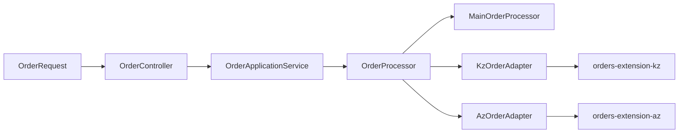

# Асинхронные заказы: отдельные библиотеки и адаптеры

Java 21, Spring Boot 3.5.16, db-scheduler 16.12.0, PostgreSQL, Flyway и MapStruct 1.6.3.
Задачи, очередь, потоки, повторы и восстановление предоставляет db-scheduler.

## Проекты и модули

Три независимых Git-репозитория остаются рядом; общая рабочая папка не является репозиторием:

```text
workspace/
├── demo-project/                    # Репозиторий demo-lib-tasks
│   ├── orders-application-api/       # OrderProcessor и данные операции, без Spring/JPA
│   ├── demo-kz-adapter/              # Маппинг и вызовы Java API KZ
│   ├── demo-az-adapter/              # Маппинг и вызовы Java API AZ
│   ├── demo-app/                    # Единственный REST-контроллер и основная цепочка
│   ├── wiremock/mappings/
│   ├── compose.yml
│   └── pom.xml
├── orders-extension-kz/             # Независимая Maven-библиотека
└── orders-extension-az/             # Независимая Maven-библиотека
```

Репозитории: [приложение](https://github.com/AbOvoUsqueAdMala/demo-lib-tasks),
[KZ](https://github.com/AbOvoUsqueAdMala/orders-extension-kz),
[AZ](https://github.com/AbOvoUsqueAdMala/orders-extension-az).
В репозитории приложения нет исходников библиотек или submodules.
Библиотеки не зависят от приложения, его POM, контрактов или адаптеров.



Каждый адаптер зависит от `orders-application-api` и своей библиотеки.
Приложение зависит от контракта и выбранных адаптеров. Циклических зависимостей нет.
Подключение адаптера транзитивно подключает библиотеку; Spring Boot AutoConfiguration
регистрирует адаптер и компоненты библиотеки. Собственных контроллеров в библиотеках нет.

## Ветки и состав сборки

| Ветка | Состав | Команда |
|---|---|---|
| `master` | Оба адаптера и обе библиотеки напрямую | `mvn clean verify` |
| `client-KZ` | Только адаптер и библиотека KZ | `mvn clean verify` |
| `client-AZ` | Только адаптер и библиотека AZ | `mvn clean verify` |
| `build-with-maven-profiles` | Ни одной, KZ, AZ или обе | См. таблицу ниже |

Текущая ветка: **`client-AZ`**, состав: **только AZ**.
В клиентских ветках и `master` зависимости обычные, флаг `-P` не нужен.
Состав Maven-модулей и зависимостей при слиянии веток нужно проверять: Git не закрепляет его автоматически.

Для выбора состава перейдите в ветку с профилями:

```shell
git switch build-with-maven-profiles
```

| Состав | Команда из корня приложения |
|---|---|
| Без библиотек и адаптеров | `mvn clean verify` |
| Только KZ | `mvn -Pextension-kz clean verify` |
| Только AZ | `mvn -Pextension-az clean verify` |
| Обе | `mvn "-Pextension-kz,extension-az" clean verify` |

Профили добавляют одновременно модуль адаптера в reactor и его зависимость в `demo-app`.
Исходники отключённого адаптера не компилируются. В итоговом JAR отсутствуют и адаптер,
и соответствующая библиотека, её модели, миграции и обработчики. На новой БД её схема не создаётся.
Основная цепочка доступна при любом составе.

## Подготовка, сборка и запуск

Нужны JDK 21, Maven 3.6.3+ и Docker. После клонирования проектов рядом из каталога
`demo-project` установите библиотеки текущей ветки:

```shell
mvn -f ../orders-extension-az/pom.xml clean install
mvn clean verify
docker compose up -d --wait
java -jar demo-app/target/demo-app-1.0.0-SNAPSHOT.jar
```

В ветке с профилями установите только выбранные библиотеки и добавьте нужный `-P`
к команде сборки. Для базовой сборки библиотеки устанавливать не нужно.
Быстрая сборка без тестов: `mvn clean package -DskipTests` с нужными профилями, если они используются.

Приложение: `localhost:8080`, PostgreSQL: `localhost:5432`, WireMock: `localhost:8081`.
БД, пользователь и пароль локального Compose — `demo`.
`docker compose down` сохраняет данные в именованном томе.
Testcontainers запускает отдельную временную БД; Compose для тестов поднимать не нужно.

### Пересборка и Maven-флаги

После изменения KZ, если приложение использует KZ:

```shell
mvn -f ../orders-extension-kz/pom.xml clean install
mvn clean verify
```

В ветке с профилями последняя команда, например: `mvn -Pextension-kz clean verify`.
Для AZ аналогично выполните `mvn -f ../orders-extension-az/pom.xml clean install`.
После изменения обеих библиотек сначала установите обе, затем соберите приложение.
Без повторного `install` Maven может использовать прежний JAR из `.m2`.
Работающее приложение нужно перезапустить.

- `-P` включает Maven-профили; это не Spring runtime profiles.
- `-pl demo-app` выбирает модуль приложения.
- `-am` (`--also-make`) добавляет его зависимости, находящиеся в текущем Maven reactor.

Теперь `mvn -pl demo-app -am clean verify` собирает также `orders-application-api`
и подключённые адаптеры. В ветке с профилями нужно добавить требуемый `-P`.
Соседние репозитории KZ/AZ в reactor не входят: `-am` их не пересобирает.

Библиотеки имеют версию `2.0.0-SNAPSHOT`: удалены REST-контроллеры, введены типизированные
команды и переименованы поля DTO. Версии не увеличиваются автоматически.
Версии зависимостей задаются свойствами `orders-extension-kz.version` / `orders-extension-az.version`.
Для другой машины установите библиотеки там либо опубликуйте JAR и POM через `mvn deploy`
в Maven-репозиторий. GitHub-репозиторий хранит исходники и сам по себе артефакты не публикует.

## Единый REST API и разные модели

Все запросы принимает `OrderController` из `demo-app`, модель запроса всегда `OrderRequest`:

```http
POST /api/orders?target=kz
Content-Type: application/json

{
  "description": "Заказ для KZ",
  "customerReference": "CLIENT-42",
  "internalComment": "Комментарий только для главного сервиса"
}
```

`target`: `main` (по умолчанию), `kz` или `az`. Запрос к отсутствующему обработчику возвращает `404`
без создания заказа и задачи. `description` обязателен, от 1 до 200 символов и не только пробелы.
`customerReference` и `internalComment` необязательны, максимум 100 и 500 символов.

Ответ — `202 Accepted`, `Location: /api/orders/{id}` и единая `OrderResponse`.
`GET /api/orders/{id}` возвращает состояние, историю и сохранённые поля главного сервиса.
Источник состояния определяется по `app.order_submissions.processor_code`.

| URL | Назначение |
|---|---|
| `POST /api/orders` | Основная цепочка; параметр `target` выбирает другую |
| `GET /api/orders/{id}` | Состояние любого нового заказа |
| `POST/GET /api/extension/kz/orders[/{id}]` | Совместимые пути KZ в том же контроллере |
| `POST/GET /api/extension/az/orders[/{id}]` | Совместимые пути AZ в том же контроллере |
| `POST/GET /api/extension/orders[/{id}]` | Прежний алиас KZ |
| `GET /actuator/health` | Состояние приложения |

Неизвестный заказ возвращает `404`, невалидный запрос — `400` через Spring ProblemDetail.

| Поле главного сервиса | Команда KZ | Команда AZ |
|---|---|---|
| `description` | `KzOrderCommand.text` | `AzOrderCommand.details` |
| `customerReference` | Не передаётся | Не передаётся |
| `internalComment` | Не передаётся | Не передаётся |

MapStruct-мапперы находятся в адаптерах, обратное преобразование `text` / `details` в `description`
тоже выполняют они. `unmappedTargetPolicy = ERROR` выявляет незаполненные целевые поля при компиляции.
Настроены `mapstruct-processor`, Lombok и `lombok-mapstruct-binding`.
REST DTO, контракт операции, DTO библиотек и JPA Entity остаются разными типами.

## Задачи, хранение и транзакции

Основная цепочка: `REGISTER_ORDER → GET_ORDER → SEND_ORDER`.
KZ: `EXT_REGISTER_ORDER → EXT_GET_ORDER → EXT_SEND_ORDER`.
AZ: `AZ_REGISTER_ORDER → AZ_GET_ORDER → AZ_SEND_ORDER`.
Все используют один Scheduler и настраиваемый пул (`SCHEDULER_THREADS`, по умолчанию 4).
Обработчик после сохранения результата и создания следующей задачи возвращает управление.
Статусы: `NEW → REGISTERED → FETCHED → SENT`, окончательная ошибка — `FAILED`.

`OrderApplicationService.create` одной JPA-транзакцией сохраняет полный запрос и маршрут
в `app.order_submissions`, заказ выбранного процессора и первую задачу.
UUID записи главного сервиса совпадает с UUID заказа процессора; `processor_code` определяет его владельца.
Библиотеки получают и сохраняют только преобразованную команду.

Starter db-scheduler использует `TransactionAwareDataSourceProxy`: его `SchedulerClient`
участвует в той же транзакции, что JPA. HTTP выполняется за пределами коротких транзакций.
После HTTP переход состояния, история и следующая задача сохраняются атомарно.
Используются блокировка строки, проверка статуса и `scheduleIfNotExists`, поэтому повтор родителя
не создаёт уже выполненный дочерний шаг заново. Параллельные заказы блокируют разные строки.

HTTP `408`, `429`, `5xx` и ошибки соединения повторяет встроенный failure handler db-scheduler.
По умолчанию пять повторов с backoff 2, 4, 8, 16, 32 секунды; остальные HTTP `4xx`
и некорректный внешний ответ переводят заказ в `FAILED`. Connect/read timeout: 2/5 секунд.
Незавершённые задачи переживают перезапуск; picked-задачи восстанавливает dead-execution handler.
Immediate execution отключён, задачи подбираются после commit polling-механизмом.

HTTP-вызовы не входят в транзакцию PostgreSQL. При сбое после внешнего эффекта возможен повтор.
Передаётся стабильный `Idempotency-Key: <taskName>:<UUID>`; реальная внешняя система должна
дедуплицировать его. WireMock не является полноценным хранилищем внешних побочных эффектов.

## Миграции и обновление

| Владелец | Схема | Миграции | История |
|---|---|---|---|
| Приложение | `app` | `classpath:db/migration/app` | `app.app_schema_history` |
| KZ | `orders_extension` | `classpath:orders-extension-kz/db/migration` | `orders_extension.extension_schema_history` |
| AZ | `orders_extension_az` | `classpath:orders-extension-az/db/migration` | `orders_extension_az.az_schema_history` |

`V3__create_order_submissions.sql` добавляет таблицу полного запроса; старые миграции не изменяются.
У библиотек сохранены SQL-колонки, схемы и имена задач, поэтому ожидающие задачи продолжают работать.
Старые основные заказы читаются через `/api/orders/{id}`; старые заказы библиотек без записи маршрута —
через соответствующий совместимый URL `/api/extension/{country}/orders/{id}`.
Для новых заказов используется единый GET и сохранённый маршрут.

Hibernate работает с `ddl-auto=validate`. Инициализаторы Flyway выполняются до JPA и Scheduler.
При отключении ранее использованной библиотеки её таблицы остаются в БД.
Перед отключением дождитесь завершения её задач; учитывайте `db-scheduler.delete-unresolved-after`.

## Проверки и IntelliJ IDEA

`mvn clean verify` запускает PostgreSQL Testcontainers и WireMock. Docker обязателен.
Тесты определяют доступные расширения по classpath, без `extension.*.expected` и системных флагов.
Проверяются четыре состава JAR, отсутствие отключённых адаптеров, API и схем, один Scheduler,
маппинг в обе стороны, отсутствие утечки полей главного сервиса, rollback, upgrade существующей БД,
повторы, параллельные цепочки и восстановление после перезапуска.
В ветке с профилями GitHub Actions запускает матрицу из четырёх сборок.
Каждая библиотека дополнительно проверяется независимым приложением без веб-сервера.

Откройте корневой `demo-project/pom.xml` в IDEA: контракт и адаптеры будут Maven-модулями.
В ветке с профилями выбирайте `extension-kz` / `extension-az` в Maven → Profiles и обновляйте проект.
Соседние репозитории библиотек открывайте отдельно; после их изменений выполняйте `mvn install`.

Если Windows использует длинный TEMP и JVM выдаёт `Unable to establish loopback connection`,
задайте короткий путь только для текущего PowerShell-процесса:

```powershell
New-Item -ItemType Directory -Force .build/tmp | Out-Null
$env:TEMP = (Resolve-Path .build/tmp).Path
$env:TMP = $env:TEMP
mvn clean verify
```

Настройки: `DATABASE_URL`, `DATABASE_USER`, `DATABASE_PASSWORD`, `DATABASE_POOL_SIZE`,
`SCHEDULER_THREADS`, `ORDERS_BASE_URL`, `KZ_ORDERS_BASE_URL`, `AZ_ORDERS_BASE_URL`,
`ORDER_RETRY_DELAY`, `ORDER_MAX_RETRIES`. URL внешних систем по умолчанию — `http://localhost:8081`.
Для KZ `EXTENSION_ORDERS_BASE_URL` остаётся резервным значением.
