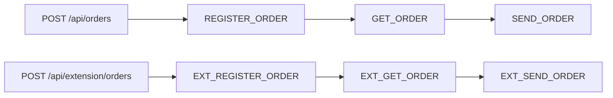

# Асинхронные цепочки заказов и Maven-расширение

Демонстрационный проект на Java 21, Spring Boot 3.5.16 и db-scheduler 16.12.0.
Очередь, блокировки задач, пул исполнителей, heartbeat, восстановление и backoff
предоставляет db-scheduler со Spring Boot Starter. Собственных executor, очередей,
планировщиков и фоновых relay-процессов нет.

## Запуск

Нужны JDK 21, Maven 3.6.3+ и работающий Docker с Linux-контейнерами.
Команды выполняются из корня проекта.

```shell
docker compose up -d --wait
mvn clean verify
java -jar demo-app/target/demo-app-1.0.0-SNAPSHOT.jar
```

PostgreSQL доступен на `localhost:5432`, WireMock — на `localhost:8081`,
приложение — на `localhost:8080`. База, пользователь и пароль для локального демо:
`demo`. Compose сохраняет PostgreSQL в именованном томе. WireMock использует
маппинги из каталога `wiremock/mappings`.

Для сборки с библиотекой:

```shell
mvn -Pextension clean verify
java -jar demo-app/target/demo-app-1.0.0-SNAPSHOT.jar
```

В каждом случае запускайте JAR после соответствующей сборки. Чтобы собрать без
интеграционных тестов: `mvn clean package -DskipTests` или
`mvn -Pextension clean package -DskipTests`.

Остановить инфраструктуру с сохранением данных: `docker compose down`.
Testcontainers использует отдельную временную базу и не затрагивает базу Compose.

## REST API

Основная цепочка:

```http
POST /api/orders
Content-Type: application/json

{"description":"Демонстрационный заказ"}
```

Ответ: `202 Accepted`, заголовок `Location: /api/orders/{id}` и JSON заказа.
Поле `description` обязательно, от 1 до 200 символов, не может состоять из пробелов.
Начальный статус — `NEW`.

Пример для PowerShell:

```powershell
$order = Invoke-RestMethod http://localhost:8080/api/orders -Method Post -ContentType application/json -Body '{"description":"Demo order"}'
Invoke-RestMethod "http://localhost:8080/api/orders/$($order.id)"
```

При подключённом профиле доступны:

| Метод | Путь | Назначение |
|---|---|---|
| POST | /api/orders | Запуск основной цепочки |
| GET | /api/orders/{id} | Состояние и история основного заказа |
| POST | /api/extension/orders | Запуск цепочки расширения |
| GET | /api/extension/orders/{id} | Состояние и история заказа расширения |
| GET | /actuator/health | Проверка состояния приложения |

История содержит имя шага, `SUCCESS` или `FAILURE`, результат, краткую ошибку и время.
Результат регистрации — внешний идентификатор, получения — JSON заказа,
отправки — подтверждение `Delivered`. Неизвестный UUID возвращает `404`,
невалидный запрос — `400`; используется Spring ProblemDetail.
Заказы двух систем имеют отдельные пространства идентификаторов и GET-методы.

## Структура

```text
demo-app/
  src/main/java/com/example/demo/
    controller/
    model/dto/
    model/entity/
    repository/
    service/
    tasks/
    config/
  src/main/resources/db/migration/app/
  src/test/java/com/example/demo/OrderChainsIT.java
orders-extension/
  src/main/java/com/example/extension/
    controller/
    model/dto/
    model/entity/
    repository/
    service/
    tasks/
    config/
  src/main/resources/
    db/migration/extension/
    META-INF/spring/org.springframework.boot.autoconfigure.AutoConfiguration.imports
wiremock/mappings/
compose.yml
```

## Выполнение и транзакции



Статусы: `NEW → REGISTERED → FETCHED → SENT`; при окончательной ошибке — `FAILED`.
Каждый шаг — отдельная одноразовая задача db-scheduler. В payload задачи хранится
только UUID через instance ID; бизнес-данные читаются из JPA.

1. Создание заказа и постановка `REGISTER_ORDER` выполняются в одной JPA-транзакции.
2. Обработчик читает заказ, затем вызывает HTTP вне транзакции и блокировки строки.
3. Короткая транзакция `complete` блокирует строку заказа, проверяет ожидаемый статус,
   сохраняет результат и ставит следующий шаг через `scheduleIfNotExists`.
4. После commit обработчик возвращает управление db-scheduler. Удаление завершённой
   задачи выполняет сама библиотека. Ожидания дочернего шага нет; он может стартовать
   на другом потоке сразу после commit.

Стартер db-scheduler 16.12.0 оборачивает DataSource в
`TransactionAwareDataSourceProxy`. Его `SchedulerClient` участвует в той же
транзакции `JpaTransactionManager`, что и Hibernate: запись заказа, история
и INSERT следующей задачи откатываются вместе. Отдельной after-commit постановки нет.
Immediate execution отключён; задачи подбираются polling после видимости commit.

Ключ очереди — пара `(task_name, task_instance)`, instance ID равен UUID заказа.
Дополнительно переход состояния защищён блокировкой и проверкой статуса: если процесс
упал после commit, но до удаления родительской задачи, её повторный запуск пропустит
уже выполненный шаг. Даже если дочерняя задача уже удалена после выполнения,
сохранённый статус не позволит повторно создать её.

Заказы независимы; блокировка берётся только на конкретный заказ и только на время
сохранения. Общий пул db-scheduler по умолчанию содержит четыре потока.

## Повторы и восстановление

- HTTP `408`, `429`, `5xx`, ошибки соединения и timeout передаются db-scheduler
  для повторного запуска. RestClient сам повторов не добавляет.
- Остальные HTTP `4xx`, ошибки декодирования ответа регистрации и некорректный
  ответ регистрации/пустой ответ получения
  переводят заказ в `FAILED` без создания следующей задачи.
- Встроенный `FailureHandler.maxRetries` выполняет по умолчанию пять повторов
  после первой попытки с backoff: 2, 4, 8, 16, 32 секунды. После исчерпания
  повторов заказ становится `FAILED`, задача удаляется, история сохраняется.
  Неожиданные ошибки обработчика, включая ошибки БД, также обрабатывает этот handler.
- Connect timeout — 2 секунды, read timeout — 5 секунд. Для WireMock выбран HTTP/1.1.
- После штатного рестарта сохранённые ожидающие задачи подбираются автоматически.
  После аварийного завершения picked-задачи возвращает в обработку стандартный
  dead-execution handler по истечении heartbeat-порога и очередной проверки.
  При настройках демо порог — 30 секунд; это не обещание точного времени восстановления.

HTTP-вызов и commit PostgreSQL не являются распределённой транзакцией. При падении
после внешнего эффекта, но до commit HTTP может повториться. Для POST передаётся
стабильный `Idempotency-Key: <имя задачи>:<UUID>`; реальный получатель должен
обеспечивать долговременную дедупликацию по этому ключу. WireMock проверяет наличие
ключа, возвращает детерминированный внешний ID и не моделирует реальное хранилище
внешних побочных эффектов. Гарантия exactly-once HTTP здесь не заявляется.

## Независимые миграции

| Владелец | Схема PostgreSQL | Путь миграций | Таблица истории |
|---|---|---|---|
| Приложение | app | classpath:db/migration/app | app.app_schema_history |
| Библиотека | orders_extension | classpath:db/migration/extension | orders_extension.extension_schema_history |

В каждой схеме свои `V1` без конфликта версий. Общая очередь
`app.scheduled_tasks` создаётся миграцией приложения `V2`.
Оба Flyway запускаются через `FlywayMigrationInitializer`; Hibernate и db-scheduler
зависят от завершения инициализации базы. Hibernate только проверяет схему:
`ddl-auto=validate`.

Оба модуля всегда входят в Maven reactor и доступны IDE для анализа исходников.
Без профиля `extension` приложение не зависит от библиотеки и не включает её
в `BOOT-INF/lib`. Её классы, миграции, Entity, Repository, обработчики и REST API
отсутствуют в приложении. На новой базе схема `orders_extension` не создаётся.
При запуске базовой сборки на базе, ранее использовавшей расширение, существующие
таблицы расширения сохраняются: приложение ничего не удаляет. Для незавершённых
EXT-задач нужно оставить библиотеку подключённой до завершения обработки;
базовая сборка не имеет их обработчиков.

## Подключение Maven-библиотеки

В этом reactor profile `extension` добавляет зависимость библиотеки в `demo-app`.
У библиотеки нет зависимости на приложение. Для публикации в локальный Maven:

```shell
mvn -Pextension clean install -DskipTests
```

В другом совместимом Spring Boot-приложении добавьте зависимость:

```xml
<dependency>
    <groupId>com.example</groupId>
    <artifactId>orders-extension</artifactId>
    <version>1.0.0-SNAPSHOT</version>
</dependency>
```

Автоконфигурация импортирует сервисы, контроллер, task beans, JPA Entity и Repository
библиотеки без `@ComponentScan` в её пакеты и без ручного изменения приложения.
Нужны PostgreSQL DataSource, JPA, Flyway и таблица общего db-scheduler.
В демо их предоставляет `demo-app`. Имя таблицы очереди задаётся общим
`db-scheduler.table-name`; отдельный Scheduler библиотека не создаёт.

## IntelliJ IDEA

Открывайте корневой `pom.xml` как Maven-проект. Оба модуля объявлены в общем
списке `<modules>`, поэтому IDEA импортирует `orders-extension` с зависимостями,
подсветкой, автодополнением и навигацией независимо от выбранного профиля.
После изменения POM выполните **View → Tool Windows → Maven → Reload All Maven Projects**
(в некоторых версиях действие называется **Sync All Maven Projects**).

Профиль **Maven → Profiles → extension** управляет подключением библиотеки
к `demo-app`. Для редактирования исходников библиотеки включать его не требуется.
При запуске приложения из IDE с активным профилем библиотека входит в classpath;
без профиля приложение запускается без неё. Команды Maven в отдельном терминале
по-прежнему требуют явного `-Pextension` для включения библиотеки в приложение.

## Настройки

| Переменная окружения | Значение по умолчанию |
|---|---|
| DATABASE_URL | jdbc:postgresql://localhost:5432/demo |
| DATABASE_USER | demo |
| DATABASE_PASSWORD | demo |
| DATABASE_POOL_SIZE | 16 |
| SCHEDULER_THREADS | 4 |
| ORDERS_BASE_URL | http://localhost:8081 |
| EXTENSION_ORDERS_BASE_URL | http://localhost:8081 |
| ORDER_RETRY_DELAY | 2s |
| ORDER_MAX_RETRIES | 5 |

Остальные настройки db-scheduler доступны через обычные Spring properties.
При увеличении числа потоков согласуйте пул БД и возможности внешних систем.

## Проверки

```shell
mvn clean verify
mvn -Pextension clean verify
```

Failsafe запускает `OrderChainsIT` после упаковки JAR. Testcontainers поднимает
PostgreSQL 17.6; WireMock стартует на случайном порту с теми же маппингами, что Compose.
Отсутствие Docker является ошибкой проверки: тесты не пропускаются автоматически.
Проверяются:

- состав итогового JAR, наличие классов расширения, одного Scheduler и 3/6 обработчиков;
- независимые миграции и отсутствие схемы/API расширения в базовой сборке;
- выполнение нескольких цепочек и перекрытие HTTP-запросов во времени;
- временные и постоянные HTTP-ошибки, повреждённый ответ регистрации,
  backoff и исчерпание повторов;
- атомарный rollback заказа/первой задачи и состояния/дочерней задачи;
- повтор родителя до и после завершения цепочки без дублирования результата;
- рестарт контекста с сохранёнными задачами и восстановление устаревших picked-записей;
- валидация REST и `404` для неизвестных заказов.

Если Windows-среда запуска использует длинный/перенаправленный TEMP и JVM выдаёт
`Unable to establish loopback connection` при старте WireMock, задайте короткий
временный путь только для текущего PowerShell-процесса:

```powershell
New-Item -ItemType Directory -Force .build/tmp | Out-Null
$env:TEMP = (Resolve-Path .build/tmp).Path
$env:TMP = $env:TEMP
mvn clean verify
mvn -Pextension clean verify
```

Документация: [db-scheduler](https://github.com/kagkarlsson/db-scheduler/tree/v16.12.0),
[транзакционная постановка](https://github.com/kagkarlsson/db-scheduler/blob/v16.12.0/examples/spring-boot-example/src/main/java/com/github/kagkarlsson/examples/boot/config/TransactionallyStagedJobConfiguration.java),
[Spring Boot 3.5](https://docs.spring.io/spring-boot/3.5/reference/).
